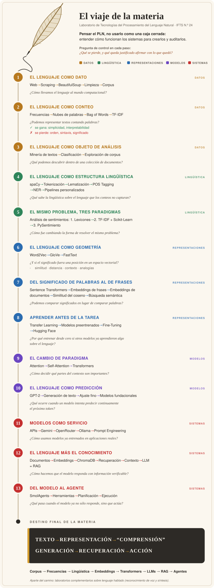

# El viaje de la materia

Laboratorio de Tecnologías del Procesamiento del Lenguaje Natural · IFTS N.º 24

Esta materia propone **pensar el PLN**, no usarlo como una caja cerrada. Atraviesa las técnicas una por una, desde contar palabras hasta las dominantes hoy (LLMs, RAG, agentes), y en cada una revisa en qué se apoya, qué supone y dónde falla. El recorrido está ordenado por la evolución de las representaciones del lenguaje, pero lo que importa no es la lista de herramientas: es entender cómo funcionan los sistemas de PLN para poder **crearlos y auditarlos**, y no solo consumirlos.

Dicho de otro modo: es una historia de las sucesivas respuestas que la computación fue dando a la pregunta «¿cómo representar el lenguaje?», desde los conteos y la estadística hasta los sistemas capaces de recuperar información y actuar mediante herramientas.

Cada estación abre con una pregunta, y la respuesta de una abre la siguiente. En todas rige una pregunta de control:

> **¿Qué se pierde en cada paso, y qué queda justificado afirmar con lo que quedó?**



<details>
<summary>Versión en texto (para terminales y lectores de pantalla)</summary>

```
                          .
                       .:'
                    .::'   /
                 .:::'    /
              .::::'     /
            .:::::'     /
           :::::::'    /
            ':::::'   /
              ':::'  /
                ''  /
                   /       E L   V I A J E
                  /        D E   L A   M A T E R I A
                 /
                '~~~~~~~~~~~~~~~~~~~~~~~~~~~~~~~~~~~~~~~~


  ◉  1 · EL LENGUAJE COMO DATO
  │
  │      Web → Scraping → BeautifulSoup → Limpieza → Corpus
  │
  │      ¿Cómo llevamos el lenguaje al mundo computacional?
  │
  ◉  2 · EL LENGUAJE COMO CONTEO
  │
  │      Frecuencias → Nubes de palabras → Bag of Words → TF-IDF
  │
  │      ¿Podemos representar textos contando palabras?
  │
  │      ✓ se gana:   simplicidad, interpretabilidad
  │      ✗ se pierde: orden, sintaxis, significado
  │
  ◉  3 · EL LENGUAJE COMO OBJETO DE ANÁLISIS
  │
  │      Minería de textos → Clasificación → Exploración de corpus
  │
  │      ¿Qué podemos descubrir dentro de una colección
  │      de documentos?
  │
  ◉  4 · EL LENGUAJE COMO ESTRUCTURA LINGÜÍSTICA
  │
  │      spaCy → Tokenización → Lematización → POS Tagging
  │      → NER → Pipelines personalizados
  │
  │      ¿Qué sabe la lingüística sobre el lenguaje que los
  │      conteos no capturan?
  │
  ◉  5 · EL MISMO PROBLEMA, TRES PARADIGMAS
  │
  │      Análisis de sentimientos
  │
  │        1. Lexicones
  │        2. TF-IDF + Scikit-Learn
  │        3. PySentimiento
  │
  │      ¿Cómo fue cambiando la forma de resolver el mismo
  │      problema?
  │
  ◉  6 · EL LENGUAJE COMO GEOMETRÍA
  │
  │      Word2Vec → GloVe → FastText
  │
  │      ¿Y si el significado fuera una posición en un
  │      espacio vectorial?
  │
  │      similitud · distancia · contexto · analogías
  │
  ◉  7 · DEL SIGNIFICADO DE PALABRAS AL DE FRASES
  │
  │      Sentence Transformers → Embeddings de frases
  │      → Embeddings de documentos → Similitud del coseno
  │      → Búsqueda semántica
  │
  │      ¿Podemos comparar significados en lugar de comparar
  │      palabras?
  │
  ◉  8 · APRENDER ANTES DE LA TAREA
  │
  │      Transfer Learning → Modelos preentrenados
  │      → Fine-Tuning → Hugging Face
  │
  │      ¿Por qué entrenar desde cero si otros modelos ya
  │      aprendieron algo sobre el lenguaje?
  │
  ◉  9 · EL CAMBIO DE PARADIGMA
  │
  │      Attention → Self-Attention → Transformers
  │
  │      ¿Cómo decidir qué partes del contexto son importantes?
  │
  ◉ 10 · EL LENGUAJE COMO PREDICCIÓN
  │
  │      GPT-2 → Generación de texto → Ajuste fino
  │      → Modelos fundacionales
  │
  │      ¿Qué ocurre cuando un modelo intenta predecir
  │      continuamente el próximo token?
  │
  ◉ 11 · MODELOS COMO SERVICIO
  │
  │      APIs → Gemini → OpenRouter → Ollama
  │      → Prompt Engineering
  │
  │      ¿Cómo usamos modelos ya entrenados en aplicaciones
  │      reales?
  │
  ◉ 12 · EL LENGUAJE MÁS EL CONOCIMIENTO
  │
  │      Documentos → Embeddings → ChromaDB → Recuperación
  │      → Contexto → LLM              =  RAG
  │
  │      ¿Cómo hacemos que el modelo responda con información
  │      verificable?
  │
  ◉ 13 · DEL MODELO AL AGENTE
  │
  │      SmolAgents → Herramientas → Planificación → Ejecución
  │
  │      ¿Qué pasa cuando el modelo ya no sólo responde,
  │      sino que actúa?
  │
  ╰──▶  DESTINO FINAL DE LA MATERIA

  ╔═════════════════════════════════════════════════════════════════════════════════╗
  ║                                                                                 ║
  ║   T E X T O   →   R E P R E S E N T A C I Ó N   →   “ C O M P R E N S I Ó N ”   ║
  ║                                                                                 ║
  ║   →   G E N E R A C I Ó N   →   R E C U P E R A C I Ó N   →   A C C I Ó N       ║
  ║                                                                                 ║
  ╚═════════════════════════════════════════════════════════════════════════════════╝

        Corpus → Frecuencias → Lingüística → Embeddings
              → Transformers → LLMs → RAG → Agentes
```

</details>

## Dónde está cada estación

| | Estación | Carpeta |
|---|---|---|
| 1 | El lenguaje como dato | `002_web_scraping` |
| 2 y 3 | Conteo y análisis | `003_text_mining` |
| 4 | Estructura lingüística | `004_spacy` |
| 5 | Tres paradigmas | `008_sentimiento` |
| 6 y 7 | Geometría y frases | `009_representaciones_semanticas` |
| 8 | Aprender antes de la tarea | `010_transfer_learning` |
| 9 | El cambio de paradigma | `011_attention_transformers` |
| 10 | El lenguaje como predicción | `012_large_language_models` |
| 11 | Modelos como servicio | `013_apis_llms` |
| 12 | Lenguaje más conocimiento | `014_rag` |
| 13 | Del modelo al agente | `015_agentes` |

Fuera del camino principal hay laboratorios complementarios sobre **lenguaje hablado**: reconocimiento de voz (`005_asr_lab`) y síntesis (`006_sintesis`). Y `001_python` es la base previa a la primera estación.
